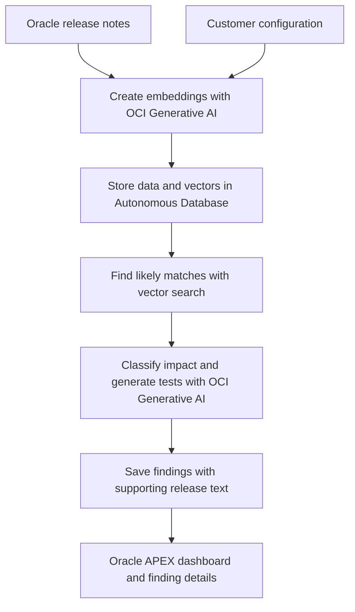

# Release Radar - Team 4

**Understand what an Oracle Fusion Cloud update means for your business—before you apply it.**

Release Radar helps teams compare Oracle Fusion Cloud release notes with their customizations, decide what to test, and discover standard features that could simplify custom work. The first website MVP provides transparent, source-linked review suggestions; live AI analysis remains a future integration.

> Import your customizations, understand related release changes, and leave with a practical testing plan.

Built for the **AI World Hackathon** by **Team 4**.

**Project status:** Initial website MVP on `develop`. Import JSON, CSV, XML or ZIP customization inventories; inspect extracted objects; review related changes from 11 real Oracle 26D notes; and download a readable report with suggested tests. The real Fusion export is pending, so native export mapping is not yet verified. The current review uses explicit matching rules, not live AI predictions. APEX static assets and installation instructions are included; deployment to the team's APEX workspace is still pending.

**Application platform: Oracle APEX.** The team will build on Autonomous Database and OCI Generative AI, with APEX providing the interface. See the [APEX deployment plan](docs/DEPLOYMENT.md).

## Try the website

```bash
python3 -m release_radar site
```

Open **http://127.0.0.1:8765** and choose **Try Northwind Telecom**, or upload a configuration inventory. Files stay in your browser. The local preview checks Oracle's public readiness index; the reviewed catalog was verified on **October 25, 2026**.

The interface is plain HTML, CSS and JavaScript and can be added to an APEX page without a Python or Node server. Run `python3 -m release_radar build-site` to package the assets. See the [MVP guide](docs/MVP.md) for the import contract, coverage, limitations and APEX installation steps.

## Start developing

Clone this repository and open a terminal in its root folder. Use **Python 3.11 or newer** for the offline development harness; it needs no third-party packages or cloud credentials.

```bash
python -m release_radar demo
python -m unittest discover -s tests -v
```

On Windows, `py` can replace `python`; on macOS/Linux, use `python3` if needed. Run from the source checkout: the demo reads the repository's `data/` and `prompts/` directories.

The demo writes `build/demo-report.json`, with six fictional Northwind Telecom objects checked against four **synthetic** release features. Expect one Breaking finding, one Needs testing finding, one Opt-in opportunity, and three objects without findings. The vectors and responses are hand-authored fixtures, so these results demonstrate the pipeline contract, not AI accuracy or actual Oracle release impacts. The demo uses release code `DEMO`, not `26D`.

| Available now | Next development work |
| --- | --- |
| Website imports, source-linked 26D findings and downloadable reports | Validate native Fusion export mapping and expand release coverage |
| Offline candidate matching, response validation and JSON report | OCI embeddings and live classification |
| Six sample configuration types and separate expected labels | Curate 20–30 real Oracle release items and about 25 fictional configurations |
| Oracle tables, run tracking, candidate query and reporting views | Install and verify on Autonomous Database; implement the analysis writer |
| APEX report SQL and page specifications | Create/export the APEX application and connect the interface |
| Unit tests and GitHub Actions workflow | Run cloud integration tests in the selected tenancy |

Start with the [development guide](docs/DEVELOPMENT.md), then follow the [database setup](database/README.md) and [APEX page guide](apex/README.md). See [data guidance](data/README.md) before replacing the fixtures.

## Why Release Radar?

Quarterly updates introduce changes across Oracle Fusion applications. Administrators and implementation teams need to understand how those changes affect their own scripts, workflows, integrations, reports, and page customizations.

The build plan describes a process that can take one to two weeks: read release notes, compare them with configuration spreadsheets, identify risks, and write regression tests by hand.

Release Radar aims to turn that review into a focused list of actions, with supporting release-note text for every finding. The time savings are a project goal and still need to be measured.

## Who is it for?

- **Fusion application administrators** preparing for quarterly updates.
- **Functional leads** responsible for Sales, Service, ERP, or HCM processes.
- **System integrator (SI) teams** managing releases for customers.

## What does the website provide?

Each finding connects an Oracle release feature to a customization and provides:

- A clear review category and the terms that matched.
- A short explanation of the potential effect.
- The release-note text supporting the finding.
- A regression test with steps and an expected result.

| Category | What it means | Suggested action |
| --- | --- | --- |
| **Review first** | A documented condition could affect the customization, but the condition still needs to be confirmed. | Check the affected setting or object before updating. |
| **Needs testing** | A related change may affect the configuration, but breakage is not established. | Run the generated regression test. |
| **Opt-in opportunity** | An optional new feature could replace something the customer built manually. | Evaluate whether to enable the feature. |
| **No matching note** | No rule matched the reviewed selection of notes. | Keep the object in your regular test plan; this does not prove it is unaffected. |

The dashboard shows findings by category and links to evidence and test steps.
Confidence scores, confirmed-breaking classifications and effort estimates
belong to the future validated AI workflow, not the current website.

## User journey

1. **Import a configuration.** Use an inventory for one customer or try the fictional sample.
2. **Inspect your objects.** Check their names, modules, types and descriptions.
3. **Review against 26D.** The dashboard lists related changes, with priority reviews first.
4. **Inspect a finding.** View the configuration snippet beside the supporting release-note text.
5. **Open the generated test.** Review the steps and expected result before testing in the customer's environment.
6. **Download the report.** Share the Markdown summary or use the JSON output in another tool.

The website MVP accepts a customer's normalized JSON, CSV or XML inventory, including supported files inside ZIPs. The sample inventory is fictional. Native Oracle export mapping will be added against the team's actual export.

## How it works

The planned application uses Oracle Autonomous Database for storage and vector search, OCI Generative AI for embeddings and impact analysis, and Oracle APEX for the interface. The Python harness supports offline development and the build plan's fallback integration path.



The analysis has three main steps:

1. **Embed:** Convert release features and configuration descriptions into numerical representations of their meaning.
2. **Match:** Use vector search to select likely relationships. The initial design takes up to three release features per configuration object, filters by module, and applies a distance threshold that needs tuning.
3. **Classify and cite:** Ask the language model to evaluate each candidate pair using only the supplied text, quote its evidence, and generate a test. Weak connections should return `NONE`.

| Component | Responsibility |
| --- | --- |
| Oracle Autonomous Database | Store release features, configuration objects, embeddings, and findings. |
| AI Vector Search | Narrow the release features considered for each configuration object. |
| OCI Generative AI | Generate embeddings, impact classifications, explanations, and tests. |
| SQL and PL/SQL | Coordinate the analysis and save results. |
| Oracle APEX | Provide customer/release selection, dashboards, and finding details. |
| Python with the OCI SDK | Serve as a fallback for model calls if the PL/SQL integration blocks progress. |

The primary APEX design does not require a separate application server. The Python fallback would write findings to the same database for APEX to display. The live analysis entry point is still to be implemented.

## Demo data

The build plan proposes **26D** as the demo release and **Northwind Telecom** as a fictional customer.

### Release features

Manually curate **20–30 real Oracle What's New items** for the selected release. Capture the release, module, feature title, description, and customer-action or opt-in information. Use Oracle's stated opt-in flag rather than asking the model to infer it.

### Customer configurations

Create approximately **25 fictional configuration objects**:

| Configuration type | Planned count | Example |
| --- | --- | --- |
| Groovy scripts or object functions | 5 | Require a signed quote before closing an opportunity. |
| App Composer custom objects or fields | 5 | A Site Survey object linked to a Service Request. |
| Page Composer or Visual Builder changes | 4 | A custom tab or hidden fields on a service page. |
| Workflows or approval rules | 3 | Route discounts above 15% for approval. |
| Oracle Integration Cloud (OIC) integrations | 4 | Synchronize accounts with a billing system. |
| BI Publisher (BIP) or OTBI reports | 4 | Report weekly service-request backlog. |

Each object should include its type, name, module, description, and a code or configuration snippet where useful.

Include a small set of deliberately matched examples with expected impact categories, plus unrelated objects. These provide a basic check that the analysis catches relevant changes without flagging everything. Example counts and performance figures in the build plan are illustrative, not measured results.

## MVP scope

| Priority | Planned capabilities |
| --- | --- |
| **Must have** | Curated release and configuration data; vector matching; AI classification with confidence and citations; a regression test per finding; a live APEX app with demo login and results dashboard. |
| **Should have** | A one-page executive summary and CSV/JSON configuration uploads. |
| **Could have** | CSV export of test cases and comparison of two releases. |
| **Future work** | Direct connections to Fusion environments and automatic ingestion of Oracle release content. |

The first milestone is one complete, reliable path from selecting a customer and release to reviewing cited findings and generated tests on a live URL.

## Getting started with implementation

Use the [Release Radar build plan](Release%20Radar.docx) for the SQL/PLSQL skeletons, classification prompt, detailed schedule, and demo script.

### Prerequisites

- An OCI tenancy with access to Autonomous Database and OCI Generative AI.
- A database version that supports the vector features used in the design.
- An Oracle APEX workspace and application schema.
- OCI credentials and database network access configured for model calls.
- Available embedding and chat models in the chosen OCI region.

Confirm model names, endpoints, and regional availability before adapting the document's sample code.

### Suggested build order

1. **Establish the foundation.** Provision the database, create a minimal APEX app and demo user, verify the live URL, and complete one embedding call.
2. **Prepare and load data.** Create `release_features`, `config_objects`, and `impact_findings`; load the two curated datasets and generate embeddings.
3. **Build the analysis.** Retrieve candidate matches, classify them with the supplied prompt, validate the returned JSON and cited text, and save findings under an analysis run.
4. **Build the interface.** Add the run form, severity counts, findings list, and detail page with evidence and generated tests.
5. **Validate and polish.** Check known examples, measure runtime, prepare a cached result, and add the executive summary if time permits.

The original plan budgets roughly six hours. Prioritize a working live demo, then add secondary features.

## Demo readiness checklist

- [ ] Known breaking examples are correctly identified.
- [ ] Unrelated examples do not produce false breaking alerts.
- [ ] Every finding includes supporting text that appears in its release item.
- [ ] Generated tests include clear steps and an expected result.
- [ ] Detection results are recorded against the prepared examples.
- [ ] Analysis completes within the two-minute demo target, or a cached run is ready.
- [ ] The live URL and demo login work from another device.
- [ ] A short backup video is available.

The planned 90-second demo follows one breaking finding from the dashboard to its evidence and test case, then shows an opt-in opportunity and the summary.

## Roadmap

- Import configurations directly from Fusion environments and OIC exports.
- Ingest release content automatically each quarter.
- Use administrator feedback to improve feature-to-configuration matching.
- Send generated tests to customer test-automation tools and track results.
- Pilot with two or three customers and measure time spent on release-impact analysis before and after adoption.

## Repository contents

| Path | Description |
| --- | --- |
| [README.md](README.md) | Project overview, planned workflow, scope, and implementation guide. |
| [Release Radar.docx](Release%20Radar.docx) | Original hackathon build plan, architecture, code skeletons, validation checklist, and pitch outline. |
| [release_radar/](release_radar/) | Python offline demo, candidate matching, prompt builder, and response validation. |
| [database/](database/) | Oracle schema, reporting views, candidate query and manual server checks. |
| [apex/](apex/) | Page specifications and SQL for run history, dashboard, and finding details. |
| [data/](data/) | Synthetic fixtures, separate evaluation labels, and real-data preparation guidance. |
| [prompts/classify.txt](prompts/classify.txt) | Versioned classification contract for the future model integration. |
| [config/](config/) | OCI embedding parameter example; no credentials. |
| [web/](web/) | Browser website, import validation, matching rules and report downloads. |
| [docs/MVP.md](docs/MVP.md) | Run the site, prepare an inventory, understand coverage and install in APEX. |
| [data/releases/26D.json](data/releases/26D.json) | Reviewed Oracle sources, short evidence excerpts and explicit matching rules. |
| [docs/DEVELOPMENT.md](docs/DEVELOPMENT.md) | First tasks, architecture boundaries, and acceptance criteria. |
| [docs/DEPLOYMENT.md](docs/DEPLOYMENT.md) | Selected APEX platform and deployment milestones. |
| [tests/](tests/) | Offline behavior, failure-path, and data-contract tests. |
| [.github/workflows/checks.yml](.github/workflows/checks.yml) | Python tests and demo checks for pushes and pull requests. |
