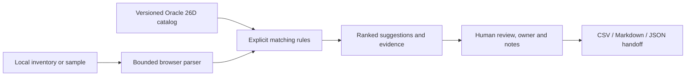

# Release Radar — Team 4

**Turn Oracle Fusion release notes into a customer-specific review and testing plan.**

Built for the AI World Hackathon. Release Radar helps Fusion administrators,
functional leads, and implementation partners connect a configuration inventory
to relevant release changes, inspect the original evidence, assign the next
action, and hand the team a portable report.

**[Open the live demo](https://sorji123.github.io/Release-Radar--Team_4-OCI/#demo)**
· **[Judge walkthrough](docs/SUBMISSION.md)**
· **[Rubric review](docs/RUBRIC_REVIEW.md)**

No login, subscription, or API key is required. Choose **Run the sample review**
for eight fictional Northwind Telecom objects reviewed against 11 real Oracle
26D notes. The public app uses explicit matching rules and makes no AI calls.
OCI Generative AI and Oracle-specific AI integration are outside the current scope.

## Why this matters

Quarterly updates create a recurring review task: identify relevant changes,
find affected customer configurations, and decide what to test. Oracle explicitly
recommends testing customizations and notes limits in visibility into custom
report data models. See the [source-backed problem and market evidence](docs/MARKET_EVIDENCE.md).

The initial target is a Fusion Sales or Service release owner in an internal
application team or implementation partner. These users need an evidence trail
and actionable handoff before a production update. Customer adoption, time savings,
and willingness to pay are hypotheses to validate, not measured results.

## What works now

1. Import a normalized JSON, CSV, XML, or ZIP inventory, or use the fictional sample.
2. Inspect extracted objects and import warnings before analysis.
3. Review ranked, source-linked suggestions: **Review first**, **Needs testing**,
   and **Opportunity**. Unmatched objects remain visible for manual review.
4. Open a finding to see matched terms, an Oracle quotation, and suggested test steps.
5. Assign an owner and record an action or review decision. Marking a finding
   verified or not applicable requires an evidence note.
6. Export the complete action plan as CSV, Markdown, or JSON. Filters never remove
   findings from the export.

The repository's Financials setup ZIP can also be imported as a **limited native
setup preview**. Four definition tables are supported; other tables are reported
as skipped. The importer does not infer which settings are custom, which product
owns them, or their release impact. These records require manual review.

Files and review decisions remain in the browser page's memory. Reloading clears
them; download the report to retain the work. No configuration data is sent to a
server, model, analytics service, or browser storage.

## Run and verify

From a source checkout with Python 3.11 or newer:

```bash
python -m release_radar site
```

Open **http://127.0.0.1:8765/#demo**. On Windows, `py` may replace `python`;
on macOS/Linux, use `python3` if needed. No package installation is required.

```bash
python -m unittest discover -s tests -v
node tests/web/core.test.mjs
node scripts/benchmark_web.mjs --output build/benchmark.json
python -m release_radar build-site
python scripts/verify_release_sources.py
```

The JavaScript checks use Node 24. Source verification needs internet access.
GitHub Actions runs the Python and JavaScript checks, enforces a matching
performance budget, and builds only the public allowlisted assets.

The [recorded benchmark](docs/benchmark.json) measures local rule matching over
8, 250, and 1,000 synthetic objects. It is not an end-to-end latency measurement,
customer time-savings study, or model accuracy score.

## Current architecture



The production preview is a static HTML/CSS/JavaScript site on GitHub Pages.
The optional local Python server serves public assets and checks Oracle's release
index. That check sends no customer data. APEX can host the same static assets;
an APEX deployment has not been verified. See [deployment instructions](docs/DEPLOYMENT.md).

## Scope and evidence limits

- The catalog contains 11 selected Sales, Service, and cross-application notes,
  not every Fusion feature. Dedicated ERP/HCM/SCM and native setup-impact rules
  are not provided.
- A match is a review suggestion, not a confirmed defect. No match does not
  establish safety. Suggested regression tests are not executed by the app.
- Review statuses are entered by a human. They are not automated test results.
- The public demo does not demonstrate novel or live AI. The original Python
  fixture harness remains separate developer test material.
- No customer interviews, paid pilots, proprietary moat, or measured business
  benefits are claimed. The [rubric review](docs/RUBRIC_REVIEW.md) identifies
  remaining proof gaps explicitly.

## Repository guide

| Area | Purpose |
| --- | --- |
| `web/` | Browser interface, import logic, matching, review decisions, exports |
| `data/releases/26D.json` | Reviewed release catalog and exact source links |
| `config/fusion-customizations.example.json` | Fictional sample inventory |
| `release_radar/site.py` | Public packaging and optional local preview |
| `tests/` | Python and browser-core regression checks |
| [MVP guide](docs/MVP.md) | Formats, limits, interpretation and APEX asset installation |
| [Development guide](docs/DEVELOPMENT.md) | Code boundaries and verification |
| [Submission guide](docs/SUBMISSION.md) | Pitch, walkthrough and technical proof |
| `database/`, `prompts/`, `release_radar/pipeline.py` | Original, separate prototype and synthetic fixture harness |
| [Original build plan](Release%20Radar.docx) | Historical project proposal; its AI architecture is not the current implementation |
