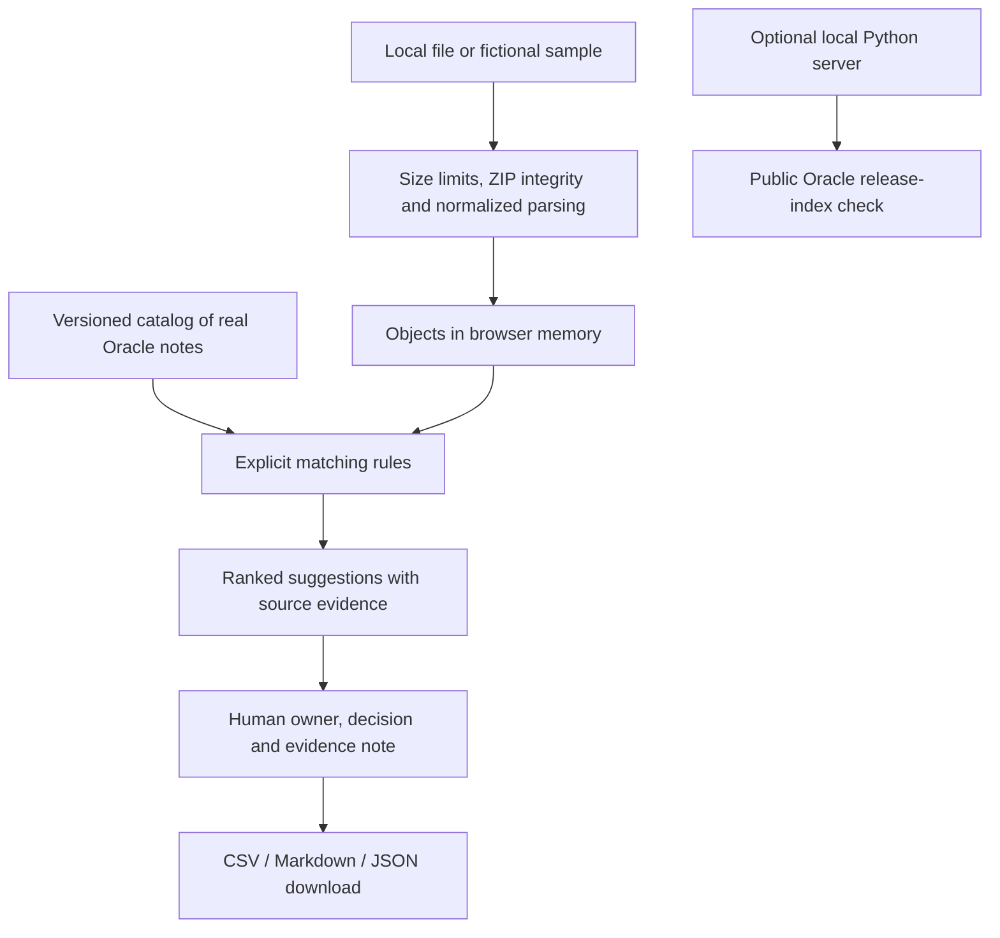

# Release Radar — judge guide

**Team 4 · [Open the demo](https://sorji123.github.io/Release-Radar--Team_4-OCI/#demo)**

No login or API key is required. Use the sample in a current Chrome, Edge, Firefox
or Safari browser. No real customer export is needed for the demonstration.

## Short pitch

Fusion release owners need to understand which quarterly changes deserve
attention in their customer's configuration. Release Radar connects an imported
inventory to reviewed Oracle notes, exposes the matching reason and source
evidence, and gives the team a test plan with an owner and a recorded decision.
The result is a portable handoff the team can inspect and correct.

The current product uses deterministic rules. It does not demonstrate live AI,
and it does not execute the suggested regression tests. Its value proposition
is a clear, traceable review workflow. Customer benefits remain to be measured.

## 90-second walkthrough

| Time | Action | What judges can verify |
| --- | --- | --- |
| 0–15 s | Open the demo and choose **Run the sample review** | No login; eight fictional objects; real Oracle 26D source catalog |
| 15–30 s | Scan the counts | Two priority reviews, two testing suggestions, two opportunities, two objects without a match |
| 30–50 s | Open **Nightly customer data extract** | BICC matching reason, exact short quotation, official source link, conditional impact and actionable test |
| 50–65 s | Set owner to **QA team**, choose **Action planned**, and record “Compare selected BIVOs against the deprecation list.” | A human decision is captured without claiming a test passed |
| 65–80 s | Download **Action plan CSV** | Owner, note, source, suggested test, expected result and unmatched objects survive the handoff |
| 80–90 s | Show **Demo & evidence** and **Release notes** | Problem evidence, before/after workflow, current architecture, scope and remaining validation |

Additional checks: filter/search; clear a zero-result filter; use browser Back;
try the sample inventory through the file picker; try an invalid file and verify
the previous review is retained. The repository's Financials ZIP demonstrates
limited native setup extraction, with unsupported tables and unassessed impact
clearly identified.

## Technical proof

- [CI runs](https://github.com/sorji123/Release-Radar--Team_4-OCI/actions):
  Python tests, browser-core tests, a matching performance budget, public build
  validation and static deployment.
- `python scripts/verify_release_sources.py`: checks all 11 catalog excerpts
  against their official Oracle pages. A network/source change can fail this
  independent check; it is not replaced with a fabricated pass.
- [Recorded benchmark](benchmark.json): 25 measured runs after a warmup at
  8, 250 and 1,000 synthetic objects. On the recorded Windows/Node 24 run,
  1,000 objects against 11 notes took **26.02 ms p95** for matching.
  This excludes parsing, rendering, networking, human review and test execution.
- The UI displays the observed matching time for each review.
- [Architecture and code boundaries](DEVELOPMENT.md) and
  [deployment/asset allowlist](DEPLOYMENT.md).
- [Verification record](VERIFICATION.md): observed browser behavior and exact
  boundaries of the tested claims.

## Current architecture and trust boundaries

The public site is static. Inventory data and decisions stay in memory; there
is no backend upload, analytics transmission, model inference or browser-storage
persistence. The optional local readiness check sends no customer data.
The older Python AI/vector harness uses synthetic fixtures and is not part of
the website execution path.

## If the venue network fails

Run `python -m release_radar site` from the checkout and open
`http://127.0.0.1:8765/#demo`. The sample and catalog are bundled. A visible
notice identifies an unavailable live freshness check; the dated catalog still
works. Downloaded reports remain usable offline. Opening an official source
link still requires network access.

## Questions to answer candidly

- **Is this AI?** The current application is deterministic; no model is called.
- **Does a priority finding mean something will break?** No. It identifies a
  documented condition that the reviewer must check.
- **Are the customers real?** Northwind is fictional. Public Oracle pages are real.
- **Have you measured business savings?** No. Only matching performance has been measured.
- **What is hard to copy?** No established moat yet. Reusable, validated mappings
  and outcomes are a potential future advantage.
- **What should the next version prove?** Independent relevance/recall evaluation,
  broader source/native-export coverage, and repeated value in customer pilots.

See the [criterion-by-criterion rubric review](RUBRIC_REVIEW.md) for evidence and
gaps. No score or judging result is guaranteed.
